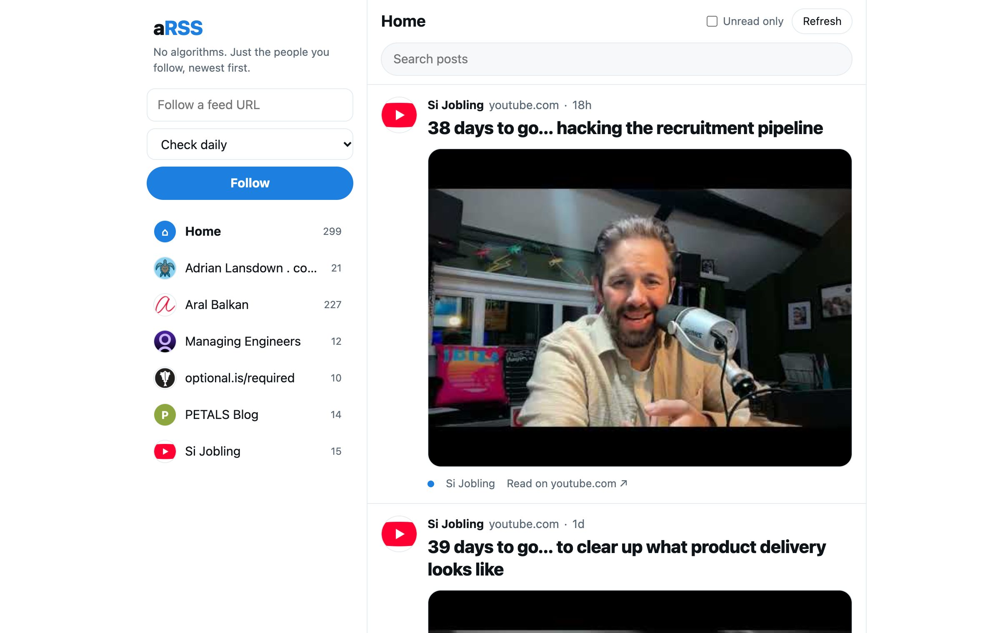

In August 2018 I wrote a README for an app called **aRSS** - "a Really Simple Syndication app". Yes, it's pronounced the way you think. That was rather the point.

The idea was a feed reader that felt like a social timeline, pulling in your friends' blogs instead of whatever an algorithm fancied showing you. Twitter was taking one of its turns for the worse, [Aral Balkan had just written about reclaiming RSS](https://ar.al/2018/06/29/reclaiming-rss/), and I got as far as a list of ideas, a list of open questions and a "who we need" section asking for designers and engineers.

Then nothing. For eight years. The repo had eight commits, all of them to the README.

This week it became a real thing. First line of code on Tuesday night, a working app with its own website by Wednesday afternoon.

---

## What changed

Not the idea - that's almost word for word what I wrote in 2018. What changed is that I could describe it to [Claude](https://claude.com/claude-code) and get working software back, instead of needing the free evenings I never had.

The nudge came from a book. I recently finished Tim Berners-Lee's [This Is for Everyone](/reading/this-is-for-everyone/), and in it he talks about RSS as a fantastic standard for sharing content - simple, open, and owned by nobody. He also points out that podcasting is built on it. Every podcast you've ever subscribed to is an RSS feed with audio attached, which is why you can listen in any app you like.

Reading the person who invented the web be that enthusiastic about a format most people think died with Google Reader was all it took. The old ideas came straight back, along with a few new ones.

The first version landed in a single sitting: a small Node server, a SQLite file, and a scheduler that checks each feed as often as you tell it to. No accounts, no build step, nothing to sign up for. It runs on my own machine.

It worked, but it looked like every other feed reader - a sidebar and a list of headlines. So the next morning I described what I'd actually had in my head all along: the good bits of old Twitter, and what Bluesky and Mastodon have been trying to get back to.

---

## A timeline, not an inbox

Each post has the site's favicon as a round avatar, the site name where a username would be, a big title, and the first 140 characters of the post. Like the good old days. If the post has a featured image, it sits underneath.

There's no ranking, no "for you", no suggested anything. It's everything you follow, newest first, and when you reach the bottom you've caught up. That's it. That's the whole algorithm.

Anything with a feed works, which turns out to be most things: blogs, podcasts, YouTube channels, Substack newsletters. Click an avatar and you see just that site's posts, a bit like visiting a profile.

It squeezes down nicely to a phone too:





A few smaller touches got added along the way:

- **Unread tracking and search**, across everything or one feed at a time
- **A "new posts" pill**, so fresh posts wait for you to ask for them instead of shoving the timeline down while you're reading
- **A check schedule per feed** - hourly for the busy ones, weekly for the friend who blogs twice a year (no judgement, I am that friend)
- **An MCP server**, so I can ask Claude things like "what was that post about swimming pool APIs I read last month?" and it searches my own feeds

---

## The £1 domain

In that 2018 README I'd noted that arss.app would cost about £11.23 a year. Eight years on I finally bought it, and it cost me a quid.

<!-- TODO Si: where you bought it and whether £1 is the first-year price -->

[arss.app](https://arss.app) is now a one-page site explaining what it is and how to run it, which Claude also put together and deployed. The cover image at the top of this post is what you'll find there.

---

## What "built with Claude" actually looked like

I didn't write the code. I'll be straight about that. What I did was say what I wanted, look at what came back, and say what was wrong with it.

Some of that was taste - "make it more like a timeline", "put the favicon in a circle". Some of it was real-world mess that only shows up when you point it at real feeds: one with bare ampersands that isn't valid XML, another returning a 404 that took the whole server down with it. Each got fixed, with a test, in minutes.

From the first line of code to the app, the website, an icon and an MIT licence was about 20 hours, and I slept through a fair chunk of them.

I've had this idea since 2018. The thing stopping me was never the idea.

---

## An MVP, on purpose

This is an early, minimal version, and deliberately so. I wanted something running that I could use myself every day before deciding what it needs next, instead of guessing.

So there's plenty missing. That 2018 README also wanted posting, resharing and comments, none of which exist yet. The list has only grown since:

- **Podcasts, properly.** Podcast feeds already show up in the timeline as posts, but they're RSS with audio attached, so there's no reason you couldn't press play right there.
- **A changelog you can subscribe to.** On a suitably meta note, aRSS will get its own RSS feed of what's changed. GitHub already publishes feeds for a repo's commits and releases, so it can probably be built on that - and then you can follow aRSS in aRSS.

I'll see which of the rest still feel like good ideas after a few weeks of actually using it.

---

## Try it

It's open source and you host it yourself, so your reading list stays yours:

- **Site:** [arss.app](https://arss.app)
- **Code:** [github.com/aRSS-app/arss-app](https://github.com/aRSS-app/arss-app)

You'll need Node, and about a minute. Paste in a feed URL and you're off.

It's early days, but my friends' blogs are all in one place again, in the order they were written, and it already feels more like the internet I signed up for.

If you've got a blog with a feed, [tell me](/contact/) and I'll follow you. Chronologically.
