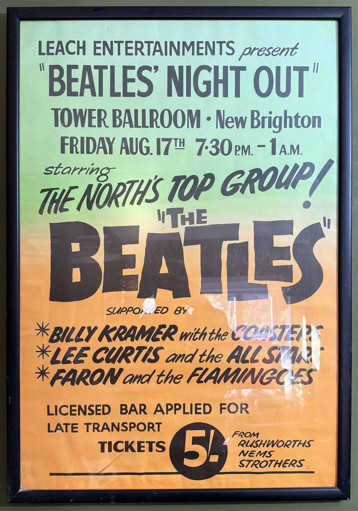

My gran left me this poster: The Beatles at the Tower Ballroom, New Brighton, Friday 17 August 1962. Tickets 5/-. Licensed bar “applied for”, so a gamble from the start.

It was the night after Pete Best got sacked. The band had no drummer, so a bloke from The Big Three filled in, and Ringo’s first official gig was the next night. “Beatles’ Night Out” was really “Beatles’ Night Without A Drummer”.

Then I looked up what these go for.

A poster from that autumn’s Tower Ballroom Arts Ball was estimated at £15,000 to £18,000 at Bonhams. A Little Richard night there sold for $14,700 with a corner missing. One dealer says they’d pay £8,000 to £10,000 for the April 1962 gig. A Cavern Club poster made £27,500.

My first thought wasn’t what to spend it on. It was whether my home insurance covered “a Beatles poster that might be worth a small car”.

Then I looked closer. It’s a 1997 reprint, worth about a tenner.

Insurance enquiry cancelled. It’s still on my wall with a cracking story, and I’m now the proud owner of a 29-year-old reprint of a 64-year-old gig.
