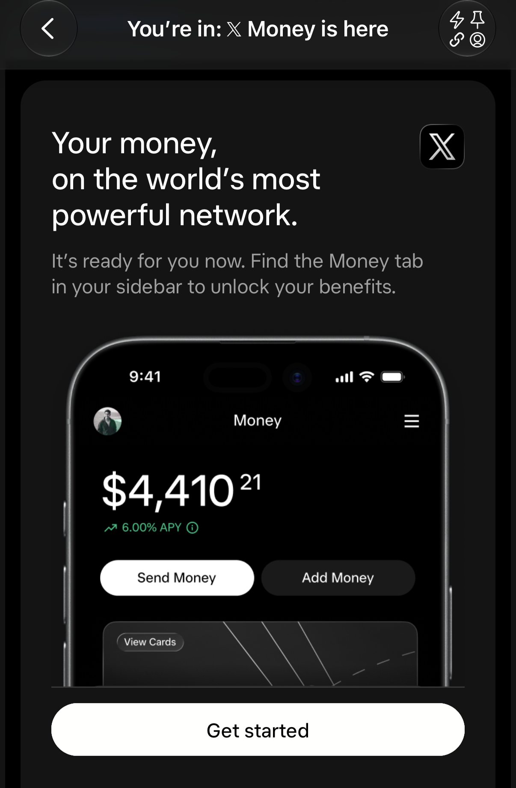

A friend told me years ago that Twitter could be the most powerful platform for distributed payments, with crypto (₿ at the time) and a connected world behind it. Then X happened, and now I've got an email saying X Money is here. Feels like too little, too late.

The more interesting question is whether it could work on open networks. I reckon it could. Handles on Bluesky and Mastodon already work like portable identity, so pointing one at a wallet is a small step. Nostr has done it for years with Lightning zaps. The hard bit isn't the tech; it's regulation and getting normal people to bother.

