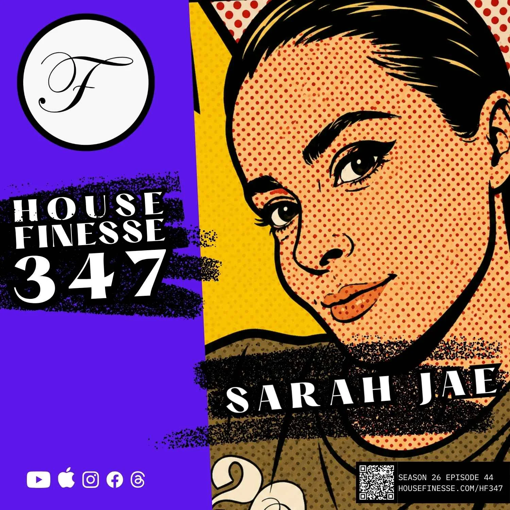

*A quieter week, as we were away on holiday at Disneyland Paris with friends and family, so most of the updates are around that. HF347 still went out on Friday.*

---

## Disneyland Paris

This was a quieter week as we've been on holiday to Disneyland Paris with friends and family, so all the updates have been around that.

It was a lovely time away, and I really enjoyed seeing the little ones (and the big ones) enjoy themselves. We also managed to hack the system with four rides in the final 40 minutes of the day, while everyone else was getting ready for the (mediocre) fireworks and lights display.







---

## House Finesse

[HF347](https://www.housefinesse.com/hf347) with Sarah Jae went out on Friday, a set made up entirely of tunes released this year. Crazy P's "Pawa" vocal dub sets the tone, Rocco Universal's "Space Chakra" and "Mutiny on the Sex Raft" get weird in the best way, and Purple Disco Machine's "Disco Cherry" lands right on time. It runs to 1h 2m. Sarah Jae is playing Fabric in London on 21 November for the Fump 15th anniversary.

On the site side, I added a Buffer posting script so social posts for each episode can be scheduled straight from Claude, and updated the Buffer channel IDs after a tidy-up of the connected channels on Saturday.






---

## PETALS

**Marketing site.** A round of mobile fixes went out on Thursday morning ([PR #63](https://github.com/PETALS-team/marketingsite/pull/63)): the cookie banner had a big gap above its buttons on small screens, the primary button in the mobile menu was turning white and hiding its white text, and the mobile menu now opens from the right. They went live when the PR was merged to `main`, which deploys automatically through Cloudflare. [usepetals.com](https://usepetals.com)

Here's the mobile cookie banner before and after, and the menu before and after. These screenshots were taken from a local build of the repo at a 390px-wide screen, with UIkit loaded locally because the CDN is blocked from my session.











**Blog.** No new posts were published on the marketing site this week.

**App.** The only change was a spec: [snapshot participation visibility](https://github.com/PETALS-team/app/pull/642), written up as docs with owner-only access to participation. No app changes went to production.

**Dev Time.** There wasn't one this week. With the holiday it was just async chat on the #dev-team Slack channel.

---

## On this site

- **[Micro](/micro/)** is now extended. It's my attempt to POSSE (publish on my own site, syndicate elsewhere) the micro thoughts I'd typically share on socials like Threads, Mastodon and Bluesky, and less so LinkedIn. It's all hooked up to a Claude skill, so I can quickly write a thought down in Claude and it's automatically added to [sijobling.com/micro](/micro/).
- **Buffer automation.** I've been playing around with Buffer automation directly in Claude across multiple accounts, using the API keys and Claude Code environments. It's working on House Finesse and on this site, and PETALS is still to do.
- **More content with Dispatch.** I'll look at getting more content into the site using Dispatch, now including YouTube content.





---

## Exercise

A much quieter week, with just four sessions logged: two short walks, a run and a swim.









Week-on-week compares 26 October to 1 November with 19 to 25 October. The Strava log's last entry is Friday 30 October (the sheet was last updated that morning), so anything on Saturday or Sunday isn't in yet and these numbers may be an undercount. Total time includes last week's 30-minute elliptical session on the Tuesday, which adds time but no distance.

- **Walking:** a 0.7km evening walk on Monday and a 2.2km morning walk on Thursday.
- **Running:** a 3.8km morning run on Friday in about 25 minutes.
- **Swimming:** 750m on Friday morning, straight after the run.

---

## Habits







**[MapTap](/habits/maptap/):** five wins and two losses this week, against three wins, three losses and a draw the week before. The average dropped to 734 from 815, though, and Gary's was 742 (786 last week), so he edged the averages even though I won more days. Tuesday's 913 was the best score of the week, and Sunday's 555 and Monday's 592 were the worst. Thursday's 618 lost to Gary's 897, my heaviest defeat of the week.

**[Sudoku](/habits/sudoku/):** seven days logged against six, averaging 3:39 against 3:47. Monday's 2:50 was the fastest and Wednesday's 4:41 the slowest. Last week's range was 3:09 to 4:58.

**Solitaire and Duolingo:** both logs are behind. The last entry in each is Saturday 17 October, so there's nothing to compare for the past two weeks. I need to tidy these up, and they'll be done before this goes live.

---

## Entertainment

**Watching:** TODO(Si): I couldn't fetch your Letterboxd feed from the session, and there's no Netflix or iPlayer export this week. What did you watch?

**Listening:**






There's a gap in the Spotify log. The last play recorded is Friday 30 October at 10:34pm, and nothing is logged for Saturday or Sunday, so the totals above are a floor rather than a quiet weekend. Last week's 118 is my own count by hand from the two weekly sheets, and it includes the double-logged plays.

- Monday and Tuesday were Shapeshifters and Soul Central's "Need You Now" (Sergio Flores remix), then Eminem on Tuesday evening.
- Thursday morning was a house run, with Fedde Le Grand, Camille Jones and Ida Corr, followed by Paolo Nutini and Seal.
- Friday evening was brighter-days house, with Kelli Sae, Revival House Project (two Brighter Days versions), Junior Jack and The Cube Guys.

TODO(Si): screenshots of this week's listening dashboard.

---

## How this is made

This post was assembled automatically by the `weeknotes-draft` task from Strava (the Google Sheet), the habit logs, the Spotify weekly sheets, and recent commits in `si/hf`, `petals-team/marketingsite`, `petals-team/app` and this repo. Letterboxd couldn't be fetched from the session this time, so films and TV are left as a TODO. The HF347 cover art came from an image pasted into the chat, and the PETALS before and after screenshots were taken by building the marketingsite repo locally and capturing it with Playwright. Nothing was invented to fill gaps, so anything marked TODO(Si) needs you.

---

More soon.
