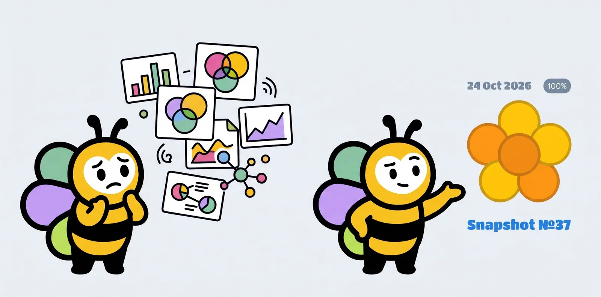
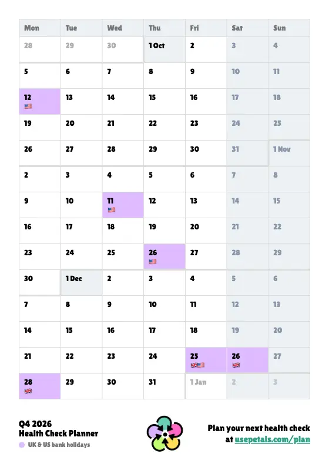
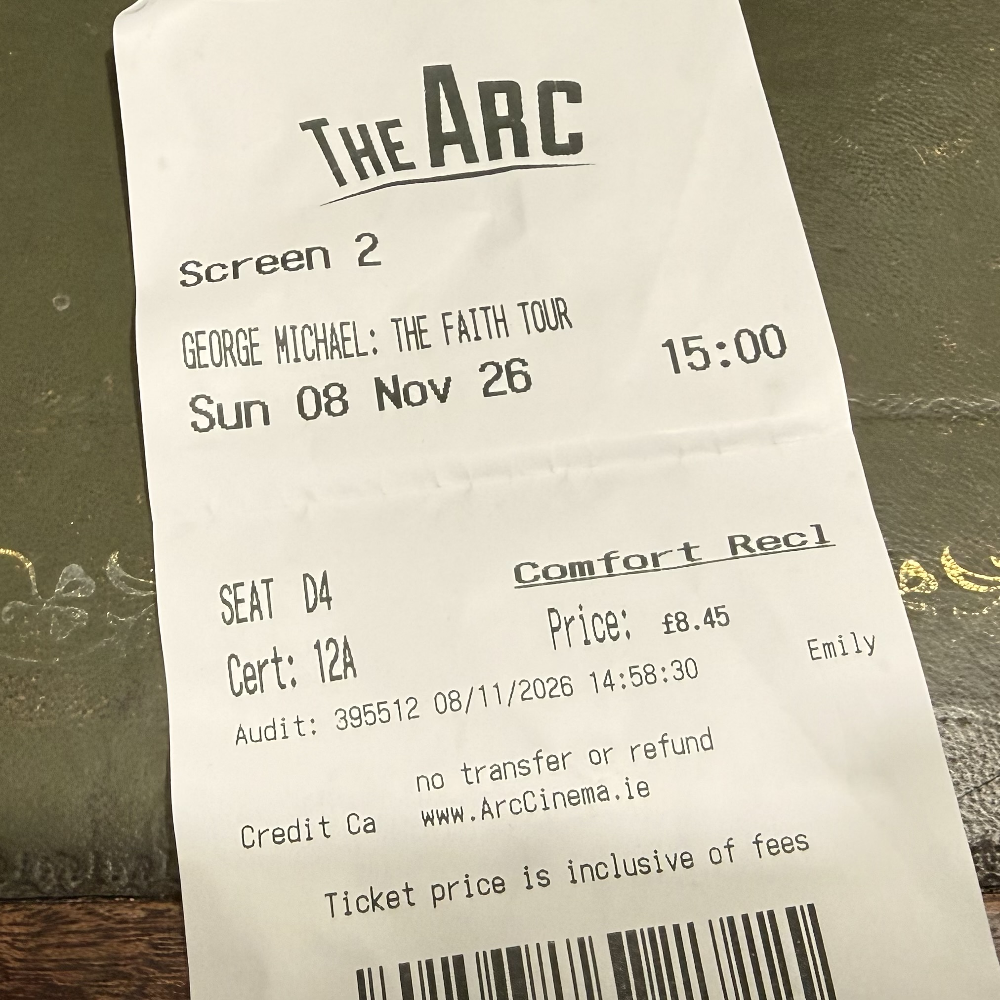

*A more normal week with little to shout about: HF348 going out on Friday, Derby County finally winning, George Michael on the big screen and a pile of new data automations.*

---

## Countdown to Head of YouTube

I missed Friday's video as I ran out of time before family commitments, but I've now released four more episodes of the [Countdown](/countdown/) series.

- [46 days to go… feeding my second brain](https://www.youtube.com/watch?v=XcuTKZP7tmo)
- [45 days to go… with town halls, village halls & all hands](https://www.youtube.com/watch?v=utRgITTSoPU)
- [44 days to go… to hand over my community legacy](https://www.youtube.com/watch?v=YVEb78yQLus)
- [43 days to go… with honest AI judgement over hype](https://www.youtube.com/watch?v=QYslT5Qc0_8)





---

## House Finesse

[HF348](https://www.housefinesse.com/hf348) with DJ Tai went out on Friday, a soulful, vocal-led session of gospel-tinged house. Sir Piers and Monique Bingham open the show, Loleatta Holloway gets the Louie Vega and Yvonne Turner treatment, and Todd Terry's "Just Make That Move" keeps the middle stretch moving. Kenny Bobien turns up twice before Ralphi Rosario's "Gotta New Love" and a gospel-house closer in Kirk Franklin's "Stomp". It runs to 1h 50m.

On the site side, the Buffer posting script now handles Facebook and Instagram too (post type and image support), so more of the episode promo can be scheduled from Claude.






---

## PETALS

A few things went out on the marketing site this week:

- **A new blog post**: [Who looks after the humans when the engineering manager role changes?](https://usepetals.com/blog/who-looks-after-the-humans-when-the-em-role-changes/) It sets LeadDev's "long live the engineering manager" against the Pragmatic Engineer's blunter "re-skill or retire", and argues the human side of the job is where PETALS conversations help.
- **The planner page** at [/plan/](https://usepetals.com/plan/) is refreshed for Q4 2026, with a PDF download and a teaser for the 2027 planner.
- **Design tweaks**: Lilita One weight and smoothing, better muted text contrast, and the gap in the hero removed.
- **The October newsletter** was drafted in the repo, then trimmed, given the PETALS logo and linked up to the planner.

In the app, the Slack happy path landed on Thursday (PR #670), and new snapshots and nudges now post descriptive Slack messages: the team name and closing time for a new snapshot, and a friendly reminder with the deadline for a nudge. These are released behind a feature flag, so we can test them for a few weeks first.

Adrian also added some notes capturing ideas for PETALS retention and snapshot habits.

There was a Dev Time this week, but I never got the transcript working.

<!-- TODO(Si): check the Dev Time recording and transcript later, and add anything worth sharing. -->

---

## Derby County

Two games this week, but the good news is that Derby County finally won one on Friday night, which took the edge off the drumming on Wednesday. My match report on the Patreon now includes a GIF of the final goal, to try something different.

<!-- TODO(Si): you'll add the match details later: scores, opponents, the Patreon post link, and the GIF if you want it here too. I haven't guessed any. -->

---

## Data and automations

A good week for life-tracking admin hacks:

- **Screenshot shortcut for iPhone:** saves a screenshot of the app plus the time to an iCloud folder, linked to the Action button. It's much quicker than asking Siri AI, and Claude can reliably process the screenshots for me.
- **CarPlay CSV iOS shortcut:** a new shortcut that I can use to start analysing my drives.
- **Aldi receipts:** I've been capturing grocery receipt line items for the past month, so I can start analysing my Aldi shopping habits, price variations and patterns.
- **Overcast:** playing around with the podcast API for listening habits.
- **Octopus Energy:** exploring their APIs and MCP.
- **Weight and spending logs:** more data habit improvements, plus loads more life tracking admin hacks.

---

## On this site

- **[Micro](/micro/):** I wrote about getting [feedback from my mum on the YouTube series](/micro/2026-11-06-1950/). Six points, and she subscribed for the first time.
- **Housekeeping:** npm dependencies updated and audit findings fixed (31 vulnerabilities down to 21).





---

## Exercise

A much busier week than last, with nine sessions logged: four walks, a run, three swims and an elliptical.









Week-on-week compares 2 to 8 November with 26 October to 1 November. The Strava log's last entry is Friday 6 November, so anything on Saturday or Sunday isn't in yet and these numbers may be an undercount. The elliptical session (28 minutes on Tuesday) adds time but no distance.

- **Walking:** 0.8km on Monday, then 2.9km on both Wednesday and Thursday mornings, and 1.4km on Friday.
- **Running:** a 3.7km run on Thursday evening in about 27 minutes.
- **Swimming:** 900m on Monday, 1,200m on Wednesday and a short 135m dip on Thursday after the run.

---

## Habits

I re-checked after you said there was more, but the habit logs in the repo (including main) still have nothing for 2 to 8 November, so I can't give a real week-on-week yet.








<!-- TODO(Si): find out why the habit logging processes aren't working, then catch up the four logs (MapTap and Sudoku from 2 Nov, Solitaire and Duolingo from 18 Oct) and fill in the week-on-week change for each (vs 26 Oct to 1 Nov, when MapTap averaged 734 and Sudoku 3:39). I haven't guessed any numbers. -->

---

## Entertainment

**Watching:** Lizzie and I went to see the George Michael Faith Tour performance from Paris in 1988 on Sunday afternoon. I've been looking forward to this release for ages, so expectations were high, and I wasn't disappointed. Two hours of pure indulgence, singing along to some childhood favourites. How is it 40 years old? I wrote a bit more in a [micro post](/micro/2026-11-08-2011/).

<!-- TODO(Si): get the YouTube and Netflix files, so anything else watched can be added. I couldn't reach Letterboxd from this session either. -->

**Listening:**







Wednesday was dominated by a full run through The Shapeshifters' catalogue, and they came back on Friday evening, with "Life Is A Dancefloor" and "Try My Love (On For Size)" on repeat. Eternal had a good Thursday night (7 plays across the week), Dames Brown got six plays on Wednesday afternoon, and Friday morning was Craig David, Gabrielle, Sade and Soul II Soul.

The Spotify log's last play is Friday 6 November at 11:23pm, so Saturday and Sunday are missing, not quiet. The numbers cover Monday to Friday only.

<!-- TODO(Si): get the Spotify files too, for a dashboard screenshot as in week 44 plus the unique-artist count and listening streak, which I left out as I couldn't compute them reliably. -->

---

More soon.
