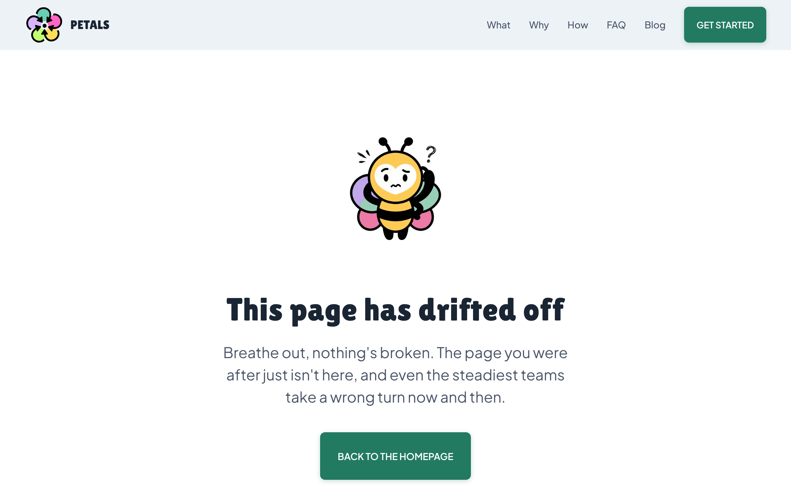
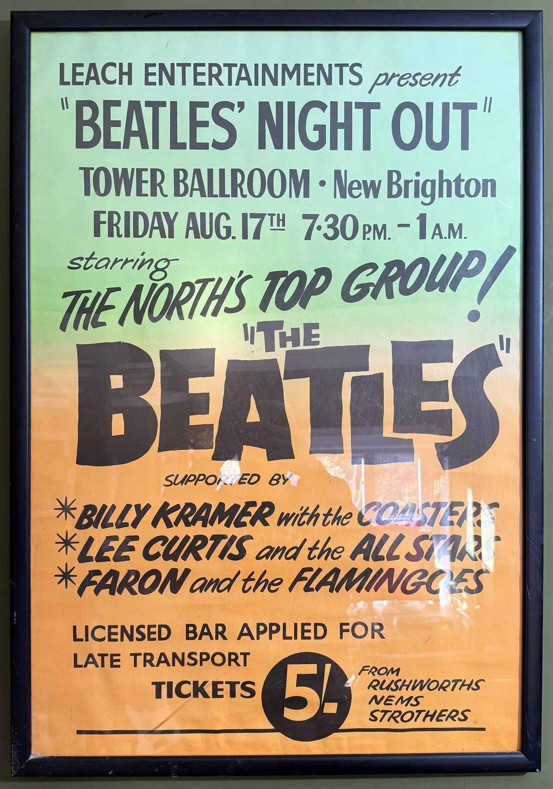

*An eight-year-old idea finally got built, HF349 went out on Friday, and a Beatles poster briefly made me think about my home insurance.*

<!-- TODO(Si): this intro and the description are a first pass from the week's data. Rewrite with whatever the week actually felt like. -->

---

## aRSS: an eight-year-old idea, built in a day

The big one this week. Back in August 2018 I wrote a README for **aRSS**, "a Really Simple Syndication app", a feed reader that feels like a social timeline of your friends' blogs. Then I did nothing with it for eight years.

After finishing Tim Berners-Lee's [This Is for Everyone](/reading/this-is-for-everyone/), where he raves about RSS as a simple, open standard owned by nobody, the idea came straight back. First line of code on Tuesday night, and by Wednesday afternoon there was a working app with its own site at [arss.app](https://arss.app), on a domain that cost me a quid.

It's a small Node server with a SQLite file. No accounts, no ranking, no "for you". Everything you follow, newest first, and when you reach the bottom you've caught up. I wrote the full story in a blog post: [aRSS app: an eight-year-old idea, built in a day](/blog/arss-app-eight-years-in-a-day/).











---

## Countdown to Head of YouTube

Four more episodes of the [Countdown](/countdown/) series went out this week:

- [39 days to go… to clear up what product delivery looks like](https://www.youtube.com/watch?v=qJOtuUqnyuM)
- [38 days to go… hacking the recruitment pipeline](https://www.youtube.com/watch?v=Vuw7DdjjAJw)
- [37 days to go… with the preferred tech toolkit](https://www.youtube.com/watch?v=ymckBSWxlhk)
- [36 days to go… normalising meeting etiquette](https://www.youtube.com/watch?v=JeMi2lQ4twU)

<!-- TODO(Si): the sync only has videos up to Thursday (36 days to go). Add Friday's if you made one, and anything you want to say about how the series is going. -->





---

## House Finesse

[HF349](https://www.housefinesse.com/hf349) with Andi King went out on Friday, a feel-good, party-ready session. Basement Jaxx and Reboot's "Do Your Thing" opens the show, Static Revenger and Michael Gray get things moving with "Happy People", Jay Vegas and Hotmood keep the energy up through the middle, and Mark Knight and James Hurr's "Miami Vice" brings it home. It runs to 1h 9m.






---

## PETALS

A tidy-up week on the marketing site, working through a batch of findings from a site audit:

- **A real 404 page.** Unknown URLs used to return a "Hello World!" with a success status. Now they get a proper [page not found](https://usepetals.com/404.html) with a puzzled bee and a calmer tone: "This page has drifted off".
- **Under the bonnet:** a [sitemap](https://usepetals.com/sitemap.xml) and [robots.txt](https://usepetals.com/robots.txt), stricter security headers, and the footer email links no longer get rewritten into broken ones.
- **A proposed privacy policy** at [/privacy/](https://usepetals.com/privacy/), rewritten from the 2023 version to match what the site actually loads.





<!-- TODO(Si): the privacy page still had items marked to confirm when it was merged. Check you're happy for it to be mentioned here before this goes live. -->

In the app, one fix went to production on Wednesday night: the survey page was telling every respondent their results would be shown by name, even on anonymous snapshots. It now takes the anonymity setting from the snapshot itself, and defaults to anonymous if it's ever unsure.

<!-- TODO(Si): was there a Dev Time this week? I had no transcript or notes to draw on. -->

---

## On this site

- **[Micro](/micro/) has its own feed** at [/micro/feed/feed.xml](/micro/feed/feed.xml), and all the feeds now carry a summary, tags and a featured image for each post. Shared links get proper social cards too, using the first image in the post.
- **[Reading](/reading/)** can now be browsed by [author](/reading/authors/) and by [series](/reading/series/).
- **A Beatles poster.** My gran left me a poster for The Beatles at the Tower Ballroom, New Brighton, from August 1962. I looked up what they go for, got as far as wondering about the home insurance, then found out [it's a 1997 reprint worth about a tenner](/micro/2026-11-14-1318/).
- **Housekeeping on autopilot.** A Claude automation now audits the site's packages every Wednesday morning and raises the updates for me to approve. I wrote [a quick micro post](/micro/2026-11-11-1255/) about it. This week's run removed unused dependencies to clear the critical and high vulnerabilities.
- **[PETALS Advent](/blog/petals-advent-2025/)**, a recap of last December's daily video series, finally got published after sitting as a draft since January.





---

## Exercise

Nothing to report yet. The Strava log hasn't had a new entry since Friday 6 November, so there's no data for 9 to 15 November to compare.









<!-- TODO(Si): the "Strava log" sheet was last updated on Sunday 8 November and its last row is Friday 6 November. Either the IFTTT sync has stopped or there were no sessions. Once it catches up, fill in this week's numbers and the change on last week (2 to 8 November: walking 8.0 km, running 3.7 km, swimming 2.2 km, 3h 51m, 14.0 km, which may itself be missing that Saturday and Sunday). I haven't guessed any. -->

---

## Habits

The habit logs are behind again, so there's no real week-on-week to give.








<!-- TODO(Si): catch up the four logs (MapTap and Sudoku from 2 November, Solitaire and Duolingo from 18 October), then fill in this week against last. The last full week on record is 26 October to 1 November, when MapTap went 5-2-0 with an average of 734 and Sudoku averaged 3:39 over seven days. I haven't guessed any numbers. -->

---

## Entertainment

**Watching:**

<!-- TODO(Si): I couldn't reach Letterboxd from this session, and had no Netflix or iPlayer exports, so films and TV are yours to add. -->

**Listening:**







Last Sunday's George Michael Faith Tour screening carried straight into the week: 12 George Michael plays across Monday night and Tuesday morning, most of them the live in Paris 1988 versions, before "Fastlove" and "Older" took over. Thursday was a Jamiroquai day, with 16 plays from "Canned Heat" to "Talullah". In between, Tuesday afternoon and Wednesday morning were new house releases, and Friday afternoon lined up with HF349, with "Do Your Thing", "Grateful" and "Party People" all getting a spin. 35 different artists in all.

The Spotify log's last play is Friday 13 November at 5:38pm, so Saturday and Sunday are missing, not quiet. This week's numbers cover Monday to Friday, against a full seven days last week.

<!-- TODO(Si): add the Spotify dashboard screenshot as in week 44 if you want it, and the listening streak, which I can't work out reliably with the weekend missing. -->

---

More soon.
