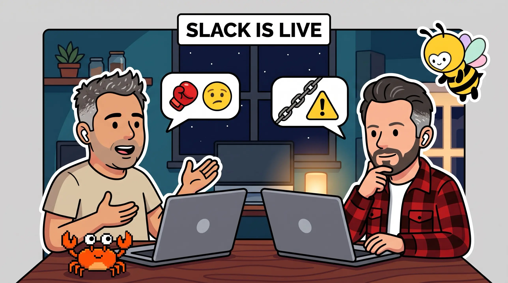

*A case study three years in the making went live, I redesigned the House Finesse Live poster by hand, and Friday was my busiest day of listening in weeks.*

Not a huge amount to write home about otherwise. I was in London on Wednesday for a big release celebration, met up with my cousin for a cheeky Nando's while she was working in the area, and spent the weekend fitting the bathroom lino to finish off this year's renovation project.

---

## What Huel learned from 3 years of PETALS

The big one this week. [Huel](https://huel.com) were one of the first companies I saw take PETALS and just run with it, and on Wednesday the write-up finally went live: [What Huel learned from 3 years of PETALS](https://usepetals.com/blog/what-huel-learned-from-3-years-of-petals/).

I sat down with Ollie Stevenson, Head of Frontend Engineering, in a pub (the best kind of research) to find out why he tried it. He first heard about PETALS at ManageOps in Birmingham, pitched it to his team as an experiment, and it stuck. They've done a ten-minute PETALS check-in at the end of every two-week sprint, before the retro, for around three years, and the backend team now runs it too.

The best bit is what their data shows. Ollie ran an analysis over their sprint history and a few patterns jumped out:

- **Productivity and Serenity pull against each other.** A high-output sprint is often followed by a calmer, slower one.
- **Enjoyment is the best single proxy** for overall team health.
- **Learning is the first thing to go** when the team ships hard.
- **Burnout has a signature:** Teamwork and Productivity fine or high, Serenity and Enjoyment sagging. A single "how did the sprint go?" would miss it.

There's also a section on PETALS in a very AI-forward company, and a phrase from his team I'm going to steal: **approachable bluntness**. For Ollie it all comes back to psychological safety.





---

## House Finesse Live

Less than three weeks to go until the first ever **House Finesse Live** party at Salt & Cellar in Chelmsford on Saturday 12 December. It's free entry from 7pm to 1am, with soulful, funky and gospel house all night.

I spent a lot of this week redesigning the poster to promote it, all by hand, no AI. It uses our latest House Finesse styles along with pop art illustrations of the DJs performing on the night. And yep, there are FIVE of us: LYP, One Phat DJ, DJ Tai, Disco 77 and Taylan.

Meanwhile on the show, [HF350](https://www.housefinesse.com/hf350) with LYP went out on Friday.






---

## PETALS

Alongside the Huel case study:

- **Dev Time with Brian:** [Slack is live, plus a free survey for the new year](https://usepetals.com/blog/slack-is-live-and-a-survey-for-the-new-year/) was held over from the week before, but it's still worth sharing. Slack notifications have shipped as a beta (connect a workspace, pick a channel, get told when a snapshot opens or closes), and we talked through shipping fast without pretending something's finished, what's still ours when Claude can build a rough version of anything, and plans for a free, PETALS-agnostic State of Team Health survey running from New Year to Valentine's Day.
- **An MCP experiment.** I've been playing with an MCP endpoint for the app: connect Claude with a personal access token, talk through your week, and it fetches and scores your current snapshot. It's definitely not ready for public consumption, but it could become an alternative UI for geeks who'd rather get and score their snapshots from Claude.
- **Security housekeeping.** Four dependency updates (certifi, msgpack, oauthlib, and social-auth for Google and Microsoft sign-in) were merged and checked on staging, including a real Google and Microsoft login. Also waiting to be promoted to production.
- **A design system page** on the marketing site at [usepetals.com/design-system](https://usepetals.com/design-system/), listing every colour, type style and component with copy-paste markup, so new pages (and Claude) stop inventing new styles.










---

## Countdown to Head of YouTube

Five more episodes of the [Countdown](/countdown/) series went out this week, from 32 days to go down to 28.

https://youtu.be/rvtpxzncf4U

https://youtu.be/EzxzKGpHsTA

https://youtu.be/2njUEr21nJw

https://youtu.be/9Zf47FDFp_Y

https://youtu.be/KB0CG1FzZg0





---

## On this site

- **[Weeknotes](/weeknotes/) have their own page, and the time-based posts are easier to browse.** There's a Blog item in the menu, a row of sub-category links between Blog, Asides, Micro, Weeknotes, Portfolio and Reading, and every post index and tag page now shows posts down a dated timeline.
- **A micro post on X Money.** An email announcing X Money arrived and [I had thoughts](/micro/2026-11-21-1413/): a friend told me years ago Twitter could be the platform for distributed payments, and the more interesting question now is whether it could work on open networks like Bluesky, Mastodon and Nostr.









---

## Exercise and habits

_(Habits and exercise sync is being refactored, will be updated at the end of the month)_

---

## Entertainment

**Watching:** a festive turn on Netflix at the weekend. [Dumplin'](https://www.netflix.com/title/80201490) on Saturday, then a Sunday of [Sex and the City: The Movie](https://www.netflix.com/title/70084801), [Click & Collect](https://www.netflix.com/title/81520310) and [Deck the Halls](https://www.netflix.com/title/70052697). I was subjected to a lot of rubbish this weekend: Christmas movies far too soon, and some girly indulgence for Mrs J.

On YouTube, the pick of the week was DJ Mag's [making of Cassius' "Feeling For You"](https://www.youtube.com/watch?v=eTcYmGbaXA8), days after I'd played it twice on Monday, alongside a [Fatboy Slim micro-documentary](https://www.youtube.com/watch?v=pjggxbgS0_E) on Better Living Through Chemistry. The rest was mostly Claude Code: [13 minutes to get disgustingly good with Claude](https://www.youtube.com/watch?v=OUbEeJOxjyw) and [5 MCP servers every Claude Code user needs](https://www.youtube.com/watch?v=aX7QAfld7hs).

**Listening:**









Very much a house week. Monday was classics on repeat, with Room 5's "Music & You" and Cassius's "Feeling For You" both played twice. Tuesday evening went the other way: Corinne Bailey Rae, Sade, Nina Simone, Bill Withers, Van Morrison and Al Green. Thursday started early with ATFC, Powerhouse, Freemasons and Junior Jack, revisited HF349 at lunchtime ("Do Your Thing" twice, "Grateful", "Party People") and then had a sneak preview of HF350 in the afternoon, with Lovebirds' "Want You In My Soul" the day before LYP opened with it.

Friday was the big one: ten Joss Stone tracks over breakfast, then disco and house through the day (Dimitri From Paris, Dam Swindle, Groove Armada and three plays of The Shapeshifters), finishing with a run of new releases from MK, Grace, Clementine Douglas, Confidence Man and more. Saturday was Jamie Cullum, 9 plays across the day, and Sunday was a short R&B blast of Estelle, Michael Jackson, Trey Lorenz and Tweet, all first plays.

Wednesday was genuinely quiet, with only 4 plays, all in the evening. Last week's 65 plays turned out to be an undercount: the weekend has since landed in the log, including 18 George Michael tracks last Saturday, which takes it to 93.

---

## How this is made

The habits and exercise sync is being rebuilt: habit screenshots are saved from my iPhone to a "Habits to sort" iCloud folder, synced to my Mac Mini and processed into JSON by regular jobs, hopefully from December. Otherwise the steps live in the `weeknotes-draft` skill in the repo. Spotify, Strava, the habit logs and the repos feed it, films come from my [Letterboxd feed](https://letterboxd.com/si/rss) and TV from what I tell it. New this week: weekly Netflix and YouTube watch-history exports feed the Watching section, and my Spotify dashboard covers the full Monday to Sunday week. Letterboxd and YouTube itself were blocked from the session, so film reviews and the Countdown episode links came from me.

---

More soon.
