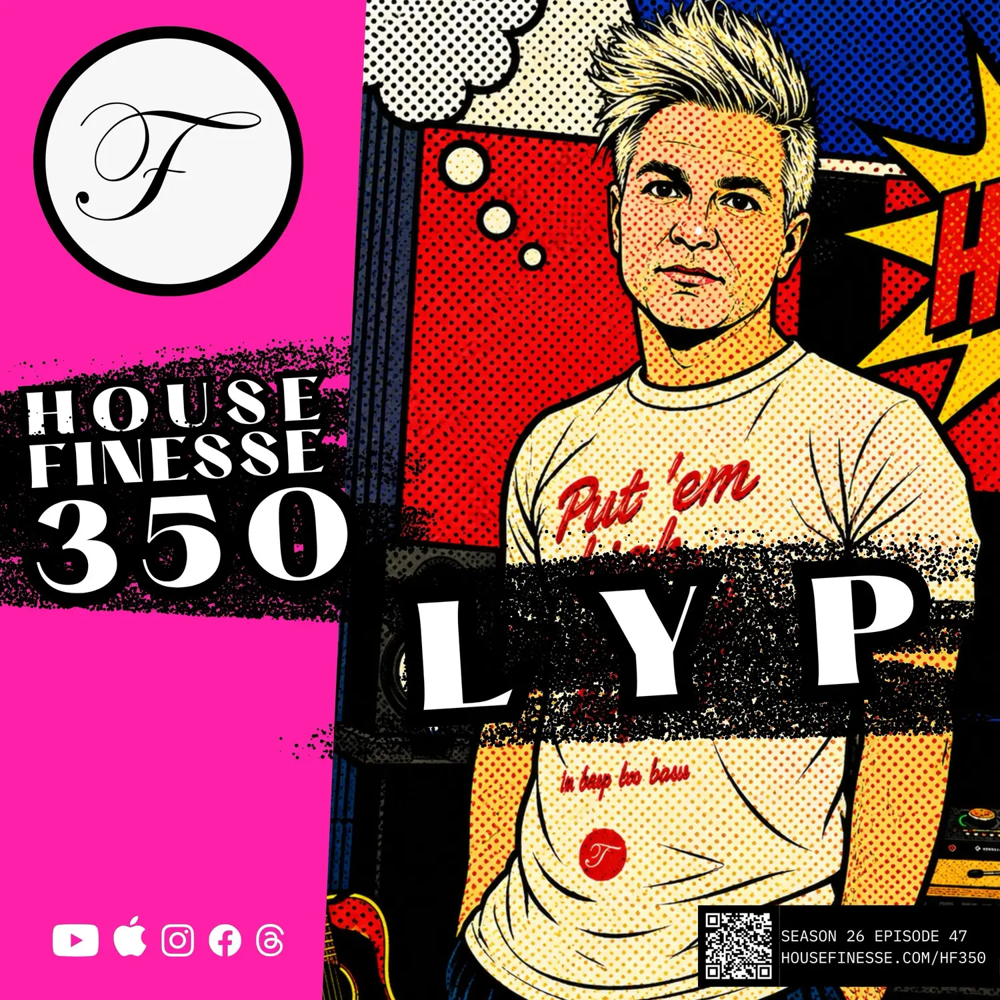

*A case study three years in the making went live, LYP came back for HF350, and Friday was my busiest day of listening in weeks.* TODO(Si): check the intro line and add anything from the week that didn't happen in a repo.

---

## What Huel learned from 3 years of PETALS

The big one this week. [Huel](https://huel.com) were one of the first companies I saw take PETALS and just run with it, and on Wednesday the write-up finally went live: [What Huel learned from 3 years of PETALS](https://usepetals.com/blog/what-huel-learned-from-3-years-of-petals/).

I sat down with Ollie Stevenson, Head of Frontend Engineering, in a pub (the best kind of research) to find out why he tried it. He first heard about PETALS at ManageOps in Birmingham, pitched it to his team as an experiment, and it stuck. They've done a ten-minute PETALS check-in at the end of every two-week sprint, before the retro, for around three years, and the backend team now runs it too.

The best bit is what their data shows. Ollie ran an analysis over their sprint history and a few patterns jumped out:

- **Productivity and Serenity pull against each other.** A high-output sprint is often followed by a calmer, slower one.
- **Enjoyment is the best single proxy** for overall team health.
- **Learning is the first thing to go** when the team ships hard.
- **Burnout has a signature:** Teamwork and Productivity fine or high, Serenity and Enjoyment sagging. A single "how did the sprint go?" would miss it.

There's also a section on PETALS in a very AI-forward company, and a phrase from his team I'm going to steal: **approachable bluntness**. For Ollie it all comes back to psychological safety.





---

## House Finesse

[HF350](https://www.housefinesse.com/hf350) with LYP went out on Friday. It's been three months since he last took the decks back at HF337, and he came back with another healthy dose of uplifting disco vibes. It opens with the Schmoov! remix of Lovebirds and Stee Downes' "Want You In My Soul", Chic get a We Are Friends re-mash on "I Want Your Love On Saturday", Riva Starr pops up twice, Basement Jaxx drop in with "Oh My Gosh", and Ridney's "Luv Musica" in a Luca Guerrieri remix closes it out.

Only three weeks now until the first ever **House Finesse Live** party: LYP, DJ Tai, One Phat DJ and Taylan at Salt & Cellar in Chelmsford on Saturday 12 December, 7pm to 1am, free to attend.






---

## PETALS

Alongside the Huel case study:

- **Dev Time with Brian:** [Slack is live, plus a free survey for the new year](https://usepetals.com/blog/slack-is-live-and-a-survey-for-the-new-year/) got its featured image this week. Slack notifications have shipped as a beta (connect a workspace, pick a channel, get told when a snapshot opens or closes), and we talked through shipping fast without pretending something's finished, what's still ours when Claude can build a rough version of anything, and plans for a free, PETALS-agnostic State of Team Health survey running from New Year to Valentine's Day.
- **Score your snapshot with Claude.** The app now has an MCP endpoint, so a team member can connect Claude with a personal access token, talk through their week, and have their current snapshot scored and saved, notes and all. The scale wording Claude sees is the same as the survey form's tooltips. It's on paid plans only, and it's merged to staging but **not in production yet**.
- **Security housekeeping.** Four dependency updates (certifi, msgpack, oauthlib, and social-auth for Google and Microsoft sign-in) were merged and checked on staging, including a real Google and Microsoft login. Also waiting to be promoted to production.
- **A design system page** on the marketing site at [/design-system/](https://usepetals.com/design-system/), listing every colour, type style and component with copy-paste markup, so new pages (and Claude) stop inventing new styles.

TODO(Si): add a screenshot of the design system page and the new "Claude access (MCP)" account page. The local build couldn't load UIkit from its CDN, so the design system page rendered unstyled, and the MCP page is only on staging.





---

## Countdown to Head of YouTube

TODO(Si): which [Countdown](/countdown/) episodes went out this week (35 days to go onwards)? There's no source for these in the session, so add the titles and YouTube links.





---

## On this site

- **[Weeknotes](/weeknotes/) have their own page**, and there's a Blog item in the menu with links between Blog, Asides, Micro, Weeknotes, Portfolio and Reading.
- **Post lists are now a dated timeline.** Every post index and tag page shows posts down a line with a date circle for each one.
- **A micro post on X Money.** An email announcing X Money arrived and [I had thoughts](/micro/2026-11-21-1413/): a friend told me years ago Twitter could be the platform for distributed payments, and the more interesting question now is whether it could work on open networks like Bluesky, Mastodon and Nostr.









---

## Exercise

Still nothing to report. The Strava log's last entry is Friday 6 November, so nothing from this week or last has come through. TODO(Si): check the Strava to Google Sheets (IFTTT) connection, or tell me what you did this week.

---

## Habits








The habit logs are still behind: [MapTap](/habits/maptap/) and [Sudoku](/habits/sudoku/) stop on 1 November, and [Duolingo](/habits/duolingo/) and [Solitaire](/habits/solitaire/) on 17 October. Those zeros are missing data, not three weeks off.

I'm refining the habits process again. Now I tap a shortcut button on my iPhone to save each app's results screenshot to a "Habits to sort" folder in iCloud. That folder should sync automatically to my Mac Mini, where regular jobs will turn the screenshots into the JSON data files behind the [habits pages](/habits/). It's still a work in progress, and it should be up and running in December.

---

## Entertainment

**Watching:** TODO(Si): films and TV this week. Letterboxd couldn't be reached from the session, and there's no Netflix or iPlayer export.

**Listening:**







Very much a house week. Monday was classics on repeat, with Room 5's "Music & You" and Cassius's "Feeling For You" both played twice. Tuesday evening went the other way: Corinne Bailey Rae, Sade, Nina Simone, Bill Withers, Van Morrison and Al Green. Thursday started early with ATFC, Powerhouse, Freemasons and Junior Jack, revisited HF349 at lunchtime ("Do Your Thing" twice, "Grateful", "Party People") and then had a sneak preview of HF350 in the afternoon, with Lovebirds' "Want You In My Soul" the day before LYP opened with it.

Friday was the big one: ten Joss Stone tracks over breakfast, then disco and house through the day (Dimitri From Paris, Dam Swindle, Groove Armada and three plays of The Shapeshifters), finishing with a run of new releases from MK, Grace, Clementine Douglas, Confidence Man and more. Saturday was Jamie Cullum, 9 plays across the day.

Last week's 65 plays turned out to be an undercount. The weekend has since landed in the log, including 18 George Michael tracks last Saturday, which takes it to 93. This week's log ends on Saturday at 9:51pm, so today isn't in yet. Wednesday only has 4 plays, all in the evening. TODO(Si): was Wednesday quiet, or is that a gap?

---

## How this is made

The habits part of the process is being rebuilt (see [Habits](#habits) above): screenshots saved from my iPhone to a "Habits to sort" iCloud folder, synced to my Mac Mini and processed into JSON by regular jobs, hopefully from December. Otherwise the steps live in the `weeknotes-draft` skill in the repo. Spotify, Strava, the habit logs and the repos feed it, films come from my [Letterboxd feed](https://letterboxd.com/si/rss) and TV from what I tell it. This week Letterboxd was blocked from the session, and the Strava and habit logs hadn't updated, so those sections are waiting on me.

---

More soon.
